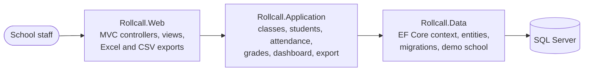

# Rollcall

**English** · [Türkçe](README.tr.md)

A school management panel for classes, students, daily attendance and grades, with exports to Excel or CSV.

[](https://github.com/Beratoguzhan620/rollcall/actions/workflows/ci.yml)


## Try it

```bash
docker compose up --build
```

Open http://localhost:8080. The demo is a small high school:

- Five classes (9-A to 11-A) with 24 students each.
- Six weeks of daily attendance. Today's attendance is taken for three classes; two are still waiting.
- Two graded written exams per course and one upcoming exam.

There is no sign-in: the app is meant for a single school's staff.

## Features

- **Classes:**
  - Grade level and section (9-A), homeroom teacher and room.
  - A class name can only exist once ("9-a" and "9-A" are the same class).
  - A class with students or records cannot be deleted.
- **Students:**
  - Unique school number, optional e-mail. Names are capitalised the Turkish way ("ayşe nur YILDIRIM" → "Ayşe Nur Yıldırım").
  - Search by name or number, class filter, paging.
  - Students who leave are marked as such instead of being deleted, so their attendance and grades stay.
- **Attendance:**
  - Pick a class and a day. Everyone starts as *present*; mark *absent*, *late* or *excused* with one tap.
  - The whole sheet is saved at once, and saving again updates rather than duplicates.
  - Future days are read-only. A live tally shows the counts before saving.
- **Exams and grades:**
  - Exams per class and course. Scores for the whole class are entered on one sheet.
  - Scores run 0–100 with up to two decimals; a comma and a dot both work. A wrong value is flagged on its row and the rest of what was typed is kept.
  - Each exam shows its average, the highest and lowest scores and the number of scores below 50.
- **Student page:**
  - Presence rate; absent, late and excused days; recent absences.
  - Course averages as bars with the pass mark (50) marked, plus the full score table.
  - The overall average gives each course equal weight.
- **Dashboard:** classes whose attendance is still missing today, today's absences and the students with the most absent days.
- **Exports:**
  - A class's attendance for any date range.
  - A class's grade book: every exam, each course average and the overall average.
  - Both as Excel (.xlsx) or CSV for Turkish Excel (UTF-8 BOM, semicolons, formula-like cells neutralised).

## Screenshots

| Attendance | Student |
|---|---|
|  |  |
| **Grade sheet** | **Class** |
|  |  |

<p align="center">
  
  
</p>

## How the records stay correct

- **One record per student per day:** a unique index on (student, date). Saving a sheet again updates the records in place.
- **Attendance keeps its class:** each record stores the class it was taken in, so moving a student to another class does not rewrite history.
- **Scores:** a check constraint keeps them between 0 and 100. Grades and attendance cannot be orphaned: students with records cannot be deleted, and exam grades go with their exam.
- **Local dates:** "today" is the date in Istanbul, not in UTC, so attendance taken late in the evening lands on the right day.

## Tech stack

- ASP.NET Core MVC on .NET 10, Razor views, Bootstrap 5 with a small design system ([docs/DESIGN.md](docs/DESIGN.md))
- Entity Framework Core 10 with SQL Server and migrations
- xUnit with in-memory SQLite for service tests, Playwright for UI checks
- GitHub Actions: build with warnings as errors, tests, pending-migration check, Docker Compose with export checks and a UI preview on every pull request
- Docker / Docker Compose

## Architecture



## Running without Docker

Requirements: .NET 10 SDK and SQL Server LocalDB (or set `ConnectionStrings__DefaultConnection`).

```bash
dotnet run --project src/Rollcall.Web --launch-profile https
```

Migrations run on start-up, and the Development settings turn on the demo data. Other settings: `Seed__DemoContent` and `DataProtection__KeysPath`.

## Tests

```bash
dotnet test
```

46 tests on an in-memory SQLite database built from the real model:

- **Classes and students:** normalising sections and names the Turkish way, duplicates, input checks, search and filters, protecting records on delete.
- **Attendance:** the local date in Istanbul, new and saved sheets, saving twice, future days, other classes, students who left, summaries, today's overview, the most absent students, export rows.
- **Grades:** exam rules, adding, changing and removing scores in one save, ranges and precision, averages, the grade book, cascade on delete, the database constraint.
- **Exports and demo data:** CSV for Turkish Excel, the workbook format, a complete demo school seeded only once.

The UI preview workflow goes through the main flows with Playwright at desktop and 360 px widths:

- Creating classes and students, and the delete rules.
- Taking attendance and entering grades.
- Downloading the exports.

It fails if a page scrolls sideways.

## Roadmap and known gaps

- Live demo.
- Sign-in with roles for teachers and the school office.
- Attendance per lesson rather than per day.
- Messages to parents about absences.

## Background

This project started as a bootcamp project and was later rebuilt from the ground up. It used to be "EduApp": an SB Admin 2 template with a student list and an unfinished class page. What changed:

- **Scope:** renamed to Rollcall, with daily attendance, exams and grades, a dashboard and exports.
- **Design:** the admin template was replaced by a consistent interface on a small design system, usable on phones.
- **Code:** split into Web, Application and Data projects; migrations instead of `EnsureCreated`; validation messages in Turkish; deletes are POST requests behind a confirmation.
- **Tests and CI:** service tests, a Docker Compose check with exports and automated UI screenshots on every pull request.

## License

[MIT](LICENSE) · Berat Oğuzhan Turğut · [GitHub](https://github.com/Beratoguzhan620)
