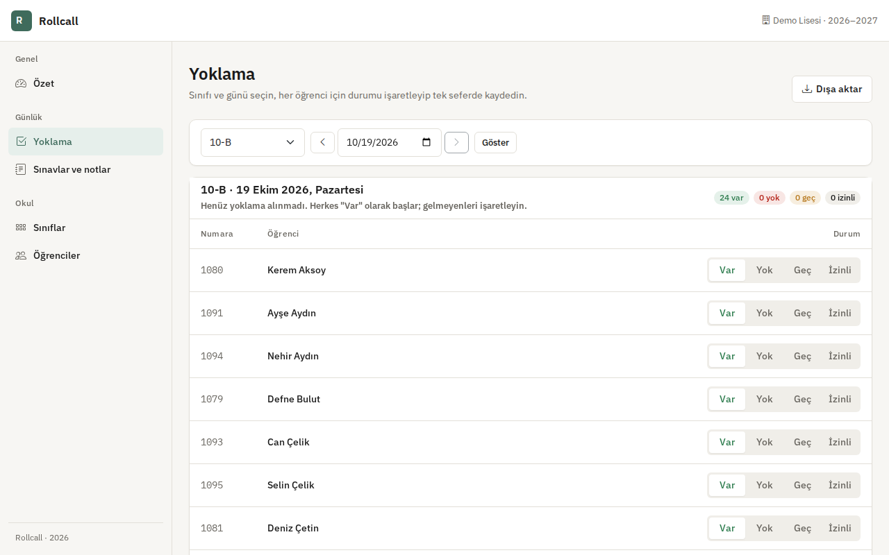
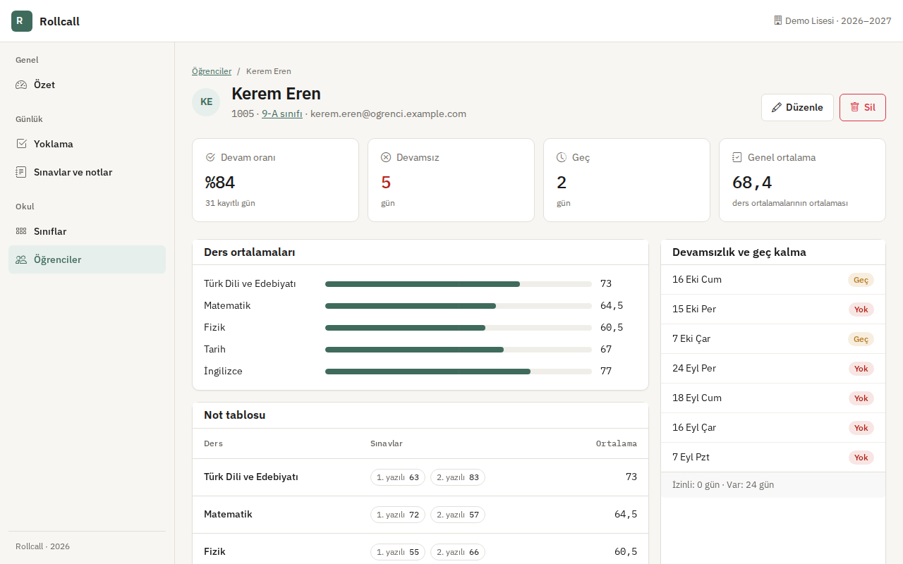
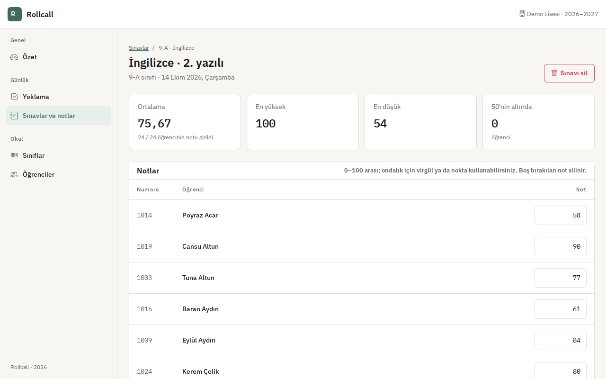
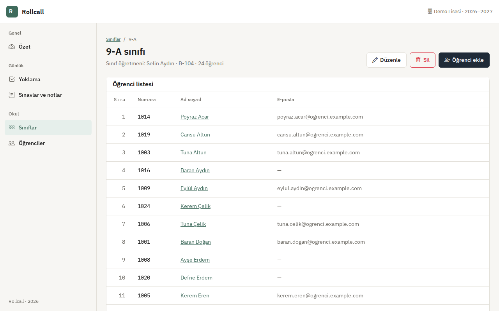
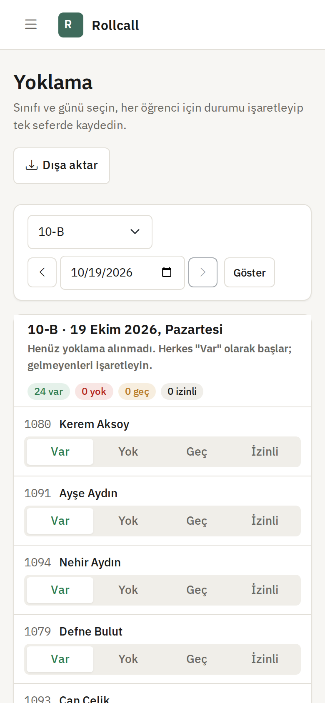
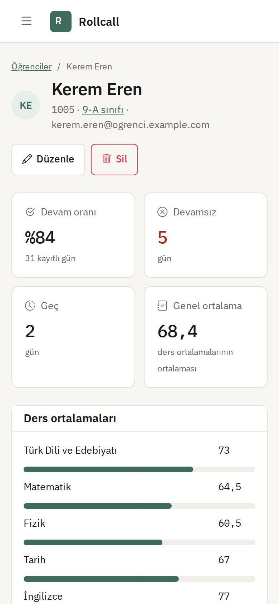
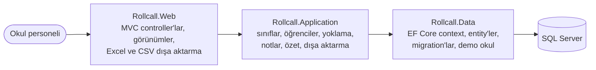

# Rollcall

[English](README.md) · **Türkçe**

Sınıf, öğrenci, günlük yoklama ve not takibi yapan; verileri Excel ya da CSV olarak dışa aktaran okul yönetim paneli.

[](https://github.com/Beratoguzhan620/rollcall/actions/workflows/ci.yml)


## Dene

```bash
docker compose up --build
```

http://localhost:8080 adresini aç. Demo, küçük bir lise:

- 9-A'dan 11-A'ya beş sınıf, her birinde 24 öğrenci.
- Altı haftalık günlük yoklama. Bugünkü yoklama üç sınıfta alınmış, iki sınıf bekliyor.
- Her derste notu girilmiş iki yazılı ve bir yaklaşan sınav.

Giriş ekranı yok; uygulama tek bir okulun personeli için tasarlandı.

## Özellikler

- **Sınıflar:**
  - Seviye ve şube (9-A), sınıf öğretmeni ve derslik.
  - Aynı sınıf adı bir kez kullanılabilir ("9-a" ile "9-A" aynı sınıftır).
  - Öğrencisi ya da kaydı olan sınıf silinemez.
- **Öğrenciler:**
  - Benzersiz okul numarası ve isteğe bağlı e-posta. Adlar Türkçe kurala göre düzeltilir ("ayşe nur YILDIRIM" → "Ayşe Nur Yıldırım").
  - Ad ya da numarayla arama, sınıf filtresi ve sayfalama.
  - Okuldan ayrılan öğrenci silinmez, "ayrıldı" olarak işaretlenir; yoklama ve notları korunur.
- **Yoklama:**
  - Sınıfı ve günü seç. Herkes "Var" olarak başlar; "Yok", "Geç" ya da "İzinli" tek dokunuşla işaretlenir.
  - Liste tek seferde kaydedilir; tekrar kaydetmek kaydı çoğaltmaz, günceller.
  - İleri tarihler yalnızca görüntülenir. Kaydetmeden önce sayılar anlık olarak gösterilir.
- **Sınavlar ve notlar:**
  - Sınıf ve ders bazında sınav tanımlanır; bütün sınıfın notları tek ekrandan girilir.
  - Notlar 0–100 arası, en fazla iki ondalıklı; virgül de nokta da kabul edilir. Hatalı not kendi satırında işaretlenir, yazılan diğer notlar kaybolmaz.
  - Her sınav için ortalama, en yüksek ve en düşük not ile 50'nin altında kalan öğrenci sayısı gösterilir.
- **Öğrenci sayfası:**
  - Devam oranı; devamsız, geç ve izinli günler; son devamsızlıklar.
  - Geçme notu (50) işaretli çubuklarla ders ortalamaları ve tam not tablosu.
  - Genel ortalamada her ders eşit ağırlıkta sayılır.
- **Özet:** bugün yoklaması alınmamış sınıflar, bugünkü devamsızlar ve devamsızlığı en yüksek öğrenciler.
- **Dışa aktarma:**
  - Bir sınıfın istenen tarih aralığındaki yoklaması.
  - Bir sınıfın not çizelgesi: tüm sınavlar, ders ortalamaları ve genel ortalama.
  - İkisi de Excel (.xlsx) ya da Türkçe Excel için CSV olarak (UTF-8 BOM, noktalı virgül, formül gibi görünen hücreler etkisizleştirilir).

## Ekran görüntüleri

| Yoklama | Öğrenci |
|---|---|
|  |  |
| **Not çizelgesi** | **Sınıf** |
|  |  |

<p align="center">
  
  
</p>

## Kayıtlar nasıl doğru kalıyor

- **Öğrenci başına günde tek kayıt:** (öğrenci, tarih) için benzersiz index var. Liste tekrar kaydedilince kayıtlar yerinde güncellenir.
- **Yoklama sınıfını unutmaz:** her kayıt alındığı sınıfı saklar. Öğrenci başka sınıfa geçse de geçmiş değişmez.
- **Notlar:** veritabanı kısıtı notu 0 ile 100 arasında tutar. Not ve yoklama sahipsiz kalmaz: kaydı olan öğrenci silinemez, sınav silinince notları da silinir.
- **Yerel tarih:** "bugün" UTC'ye göre değil İstanbul'a göre hesaplanır. Akşam geç saatte alınan yoklama doğru güne yazılır.

## Teknolojiler

- .NET 10 üzerinde ASP.NET Core MVC, Razor görünümleri, küçük bir tasarım sistemiyle Bootstrap 5 ([docs/DESIGN.md](docs/DESIGN.md))
- SQL Server ve migration'larla Entity Framework Core 10
- Servis testleri için bellek içi SQLite ile xUnit, arayüz kontrolleri için Playwright
- GitHub Actions: uyarıları hata sayan build, testler, eksik migration kontrolü, dışa aktarma kontrollü Docker Compose ve her pull request'te arayüz önizlemesi
- Docker / Docker Compose

## Mimari



## Docker olmadan çalıştırma

Gerekenler: .NET 10 SDK ve SQL Server LocalDB (ya da `ConnectionStrings__DefaultConnection` ayarı).

```bash
dotnet run --project src/Rollcall.Web --launch-profile https
```

Migration'lar açılışta uygulanır; Development ayarları demo veriyi açar. Diğer ayarlar: `Seed__DemoContent` ve `DataProtection__KeysPath`.

## Testler

```bash
dotnet test
```

Gerçek modelden kurulan bellek içi SQLite veritabanında 46 test:

- **Sınıflar ve öğrenciler:** şube ve adların Türkçe kurala göre düzeltilmesi, tekrar eden kayıtlar, girdi kontrolleri, arama ve filtreler, silmede kayıtların korunması.
- **Yoklama:** İstanbul'a göre tarih, yeni ve kaydedilmiş listeler, iki kez kaydetme, ileri tarihler, başka sınıflar, ayrılan öğrenciler, özetler, bugünün durumu, en çok devamsızlık yapanlar, dışa aktarma satırları.
- **Notlar:** sınav kuralları, tek kayıtta not ekleme, değiştirme ve silme, aralık ve ondalık kontrolü, ortalamalar, not çizelgesi, silmede notların da silinmesi, veritabanı kısıtı.
- **Dışa aktarma ve demo veri:** Türkçe Excel için CSV, çalışma kitabı biçimi, yalnızca bir kez yüklenen eksiksiz demo okul.

Arayüz önizleme iş akışı, ana akışları masaüstünde ve 360 px genişlikte Playwright ile gezer:

- Sınıf ve öğrenci ekleme, silme kuralları.
- Yoklama alma ve not girme.
- Dışa aktarılan dosyaları indirme.

Sayfa yana kayarsa test başarısız olur.

## Yol haritası ve bilinen eksikler

- Canlı demo.
- Öğretmen ve okul idaresi için rollü giriş.
- Gün yerine ders saati bazında yoklama.
- Devamsızlıkta veliye bildirim.

## Geçmiş

Bu proje bir bootcamp projesi olarak başladı, sonra baştan geliştirildi. Önceden "EduApp" adında, SB Admin 2 şablonu üzerinde bir öğrenci listesi ve yarım kalmış bir sınıf sayfasıydı. Değişenler:

- **Kapsam:** adı Rollcall oldu; günlük yoklama, sınavlar ve notlar, özet ekranı ve dışa aktarma eklendi.
- **Tasarım:** yönetim şablonu kaldırıldı; yerine küçük bir tasarım sistemi üzerinde, telefonda da rahat kullanılan tutarlı bir arayüz geldi.
- **Kod:** Web, Application ve Data projelerine ayrıldı. `EnsureCreated` yerine migration'lar kullanılıyor. Doğrulama mesajları Türkçe; silme işlemleri onaydan sonra POST ile yapılıyor.
- **Test ve CI:** servis testleri, dışa aktarma kontrollü Docker Compose ve her pull request'te otomatik ekran görüntüleri.

## Lisans

[MIT](LICENSE) · Berat Oğuzhan Turğut · [GitHub](https://github.com/Beratoguzhan620)
